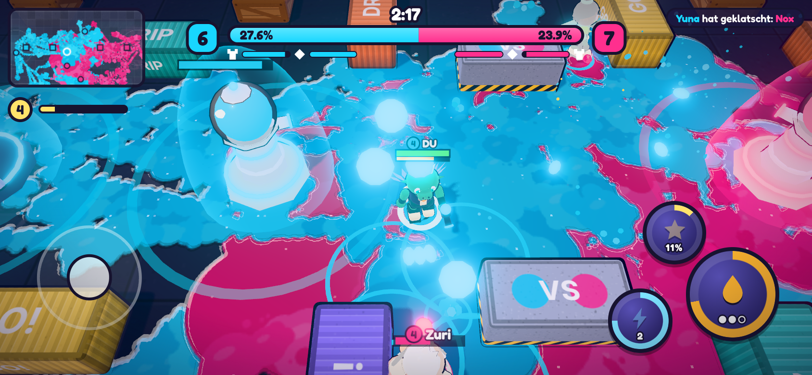
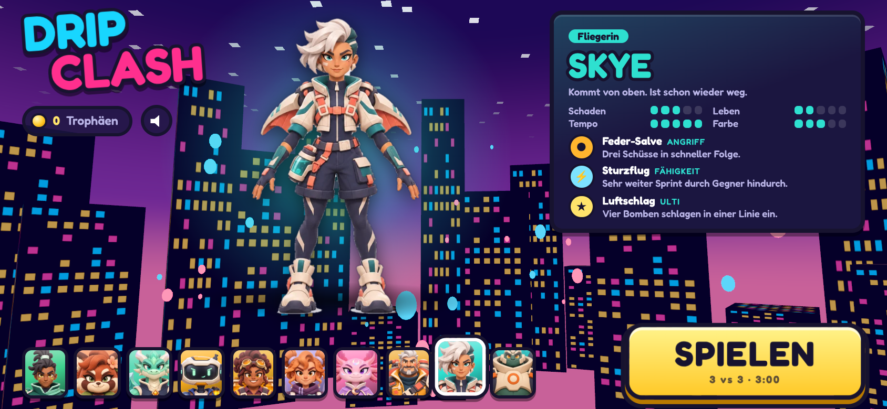

# DRIP CLASH (Arbeitstitel)

3-gegen-3 Farb-Brawler in 3D, Querformat, mobile-first. Erste spielbare Version.

Die Idee kombiniert drei Genres zu einem eigenen Spiel:

| Zutat | Was davon im Spiel steckt |
| --- | --- |
| Top-down Hero-Shooter | Kurze 3-Minuten-Matches, Twin-Stick-Steuerung, Munition + Ulti, die sich durch Treffer auflädt |
| Farb-Shooter | Jeder Schuss färbt den Boden. Eigene Farbe = schneller laufen, schneller nachladen, heilen. Gegnerfarbe bremst und schadet |
| MOBA | Lane mit Blob-Wellen, Turm und Kern pro Team, Fähigkeiten mit Cooldown, Level-ups im Match |

**Der Twist, der alles verbindet:** Türme und Kern haben ein *Farb-Schild*. Solange der Boden um sie herum nicht in
deiner Farbe ist, prallt der meiste Schaden ab. Wer den Kern zerstört, gewinnt sofort – sonst gewinnt nach 3 Minuten
das Team mit mehr Farbe auf dem Feld.




## Helden

Zehn Helden, alle nach eigenen Charakter-Designs. Das Artwork liegt in `src/assets/heroes/` und wird im Menü, auf den
Karten und im Ergebnis-Screen gezeigt. Im Match laufen vereinfachte 3D-Figuren, die im Code nach den Designs gebaut
sind (`src/models.js`).

| Held | Rolle | Angriff | Fähigkeit | Ulti |
| --- | --- | --- | --- | --- |
| **Jaro** | Flitzer | Doppel-Spray | Schattensprint | Farb-Tornado |
| **Pippa** | Gärtnerin | Samen-Salve | Heil-Pfütze | Blütenmeer |
| **Zyro** | Kämpfer | Splitter-Fächer | Kristallsturz | Kristallhagel |
| **Byte** | Tüftler | Schnellfeuer | Farbmine | Laser-Gitter |
| **Melli** | Ingenieurin | Honig-Schrot | Klebefalle | Waben-Bombe |
| **Nimbi** | Supporterin | Wolken-Blasen | Regenpfütze | Wolkenbruch |
| **Luma** | Scharfschützin | Mond-Tropfen | Mondstrahl | Farbregen |
| **Bruno** | Tank | Klecks-Kanone | Bodenstampfer | Hochdruck |
| **Skye** | Fliegerin | Feder-Salve | Sturzflug | Luftschlag |
| **Grom** | Koloss | Wasserkugel | Wasserschild | Flutwelle |

### Echte 3D-Modelle aus den Designs

Die Figuren im Match sind bewusst austauschbar gehalten. Für Modelle, die 1:1 wie das Artwork aussehen, braucht es
pro Held eine `.glb`-Datei (Modell + Skelett + Animationen: Idle, Laufen, Angriff). Wege dorthin:

- Bild-zu-3D-Dienst (z. B. Meshy, Tripo, Rodin) mit dem Artwork als Vorlage, danach Auto-Rigging (z. B. Mixamo)
- oder ein 3D-Artist, der die Figuren in Blender modelliert

Die fertigen Dateien kommen nach `public/models/<id>.glb` und werden dann über den `GLTFLoader` von Three.js statt
der Code-Figuren geladen.

## Starten

```bash
npm install
npm run dev        # Entwicklungsserver, im Handy-Browser im selben WLAN öffnen
npm run build      # Produktions-Build nach dist/
npm run build:single   # eine einzelne, eigenständige index.html nach dist-single/
```

**Steuerung Handy:** linker Daumen = Lauf-Stick. Rechts: Angriff, Fähigkeit, Ulti. Antippen = Auto-Zielen,
Ziehen = selbst zielen, Loslassen = Schuss.

**Steuerung PC:** WASD laufen, Maus zielen + schießen, Leertaste/Rechtsklick Fähigkeit, E Ulti.

Test-Parameter in der URL: `?start=1&hero=luma` (Menü überspringen), `&autoplay=1` (Bot spielt für dich),
`&lang=en` / `&lang=de`, `?models=1` (alle 3D-Figuren nebeneinander).

## Aufbau

```
src/
  main.js     App-Start, Render-Loop, Wechsel Menü <-> Match, automatische Qualitätsanpassung
  game.js     Match-Simulation: Helden, Blobs, Türme, Kern, Projektile, Zonen, Kamera
  heroes.js   Helden-Daten und ihre Angriffe/Fähigkeiten (hier neue Helden hinzufügen)
  models.js   3D-Modelle der Figuren und Gebäude + Animation
  gfx.js      Render-Pipeline (Bloom, Tone-Mapping), Glow- und Rim-Light-Helfer
  view.js     Querformat-Bühne (dreht das Spiel, wenn das Handy hochkant gehalten wird)
  ai.js       Bot-KI (Rückzug, Kampf, Farmen, Pushen, Malen)
  paint.js    Farb-System: Logik-Raster + Canvas-Textur auf dem Boden
  world.js    Arena (Boden-Shader, Deckung, Tribüne, Deko), Kollision, Wegfindung um Hindernisse
  input.js    Touch-Sticks + Tastatur/Maus
  hud.js      Anzeige im Match (Farb-Balken, Minimap, Killfeed ...)
  menu.js     Heldenauswahl und Ergebnis-Screen
  fx.js       Partikel, Ringe, Strahlen, Screen-Shake
  audio.js    Sound komplett synthetisch (keine Audiodateien)
  i18n.js     Texte Deutsch/Englisch
```

Technik: [Three.js](https://threejs.org) + [Vite](https://vite.dev). Die App ist eine Web-App, die mit
[Capacitor](https://capacitorjs.com) als native Android-/iOS-App verpackt wird.

## In die Stores bringen (Play Store / App Store)

`capacitor.config.json` ist vorbereitet (`appId` vor dem ersten Release auf eure eigene Domain ändern –
sie lässt sich später nicht mehr wechseln).

```bash
npm install @capacitor/android @capacitor/ios
npm run build
npx cap add android
npx cap add ios          # nur auf einem Mac
npx cap sync
npx cap open android     # öffnet Android Studio
npx cap open ios         # öffnet Xcode
```

Querformat erzwingen:

- **Android:** in `android/app/src/main/AndroidManifest.xml` bei der `<activity>` `android:screenOrientation="sensorLandscape"` setzen.
- **iOS:** in Xcode unter *Deployment Info* nur *Landscape Left/Right* anhaken.

Was ihr für den Upload braucht:

- Google Play Developer-Konto (einmalig 25 $), signiertes `.aab` aus Android Studio.
- Apple Developer Program (99 $/Jahr), ein Mac mit Xcode, Upload über App Store Connect.
- App-Icons und Splash-Screens (z. B. mit `@capacitor/assets` aus einer 1024×1024-Grafik erzeugen), Store-Screenshots,
  Datenschutzerklärung, Altersfreigabe (IARC-Fragebogen).
- Zielgruppe Kinder/Jugendliche: Google-„Familien"-Richtlinien und Apples Kids-Regeln beachten, in der EU DSGVO
  (keine Tracking-SDKs/Werbe-IDs ohne Einwilligung der Eltern). Die aktuelle Version sammelt keine Daten und braucht
  kein Internet.
- Den Namen „Drip Clash" vor Veröffentlichung auf Marken- und Store-Kollisionen prüfen.

## Was in dieser ersten Version noch fehlt

- Echter Online-Multiplayer (aktuell spielt man mit und gegen Bots)
- Fortschritt: freischaltbare Helden, Skins, Trophäen-Liga, tägliche Aufgaben
- Mehr Karten und Spielmodi, mehr Helden
- 3D-Modelle, die 1:1 dem Artwork entsprechen (siehe oben), Musik und Sounddesign
- Tests auf echten Geräten (bisher nur im Desktop-Browser und in der Handy-Emulation geprüft)
